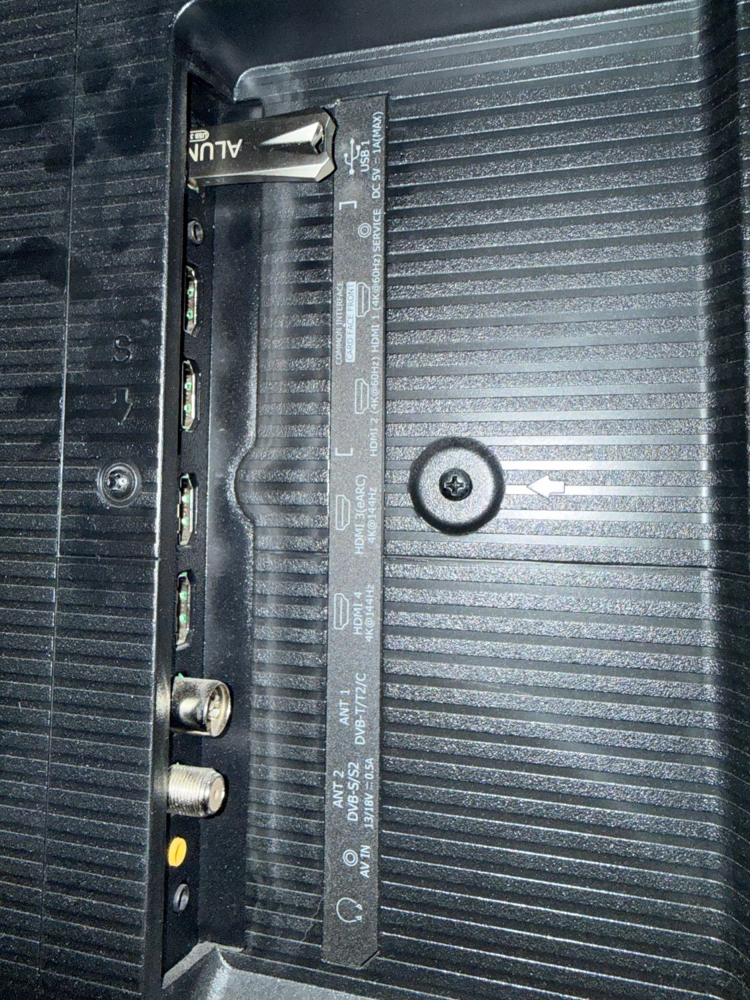
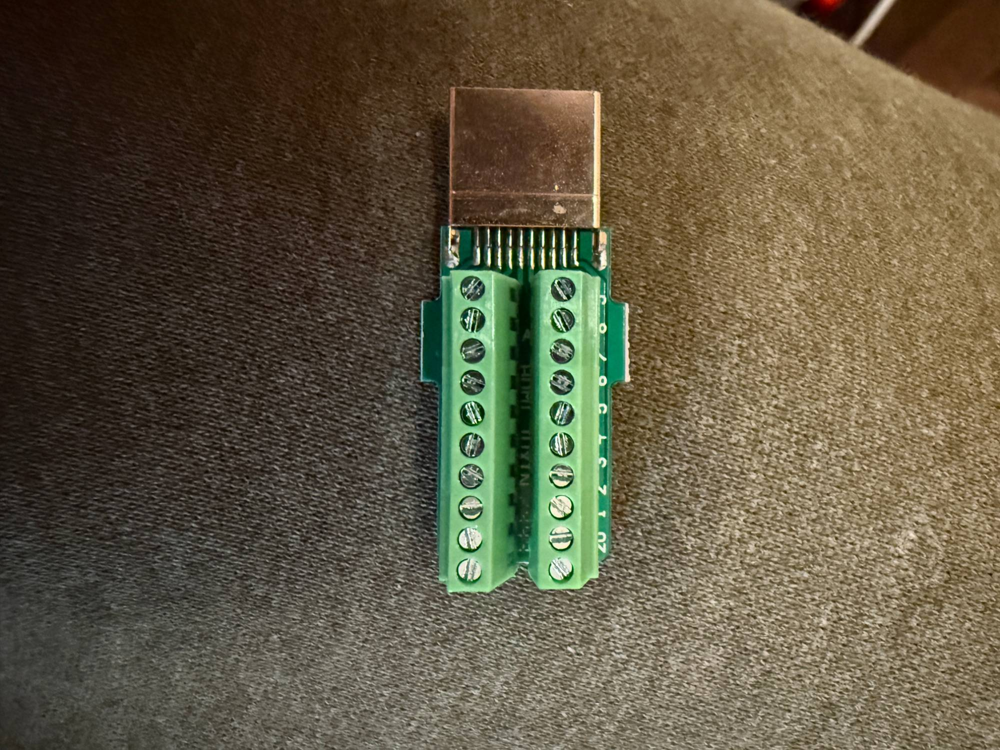
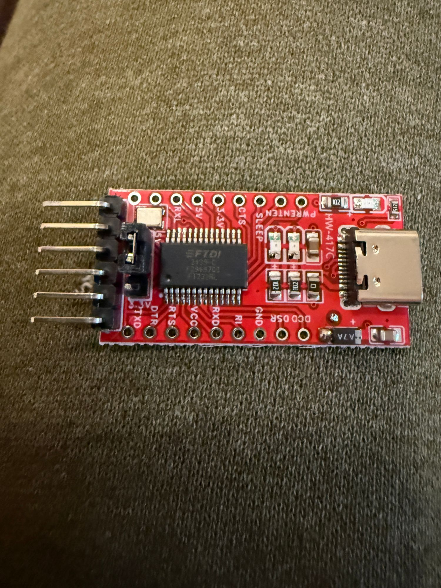

# Hisense 65U8NQ — USB Firmware Recovery

> 🇺🇦 [Українська](#українська) | 🇷🇺 [Русский](#русский) | 🇬🇧 [English](#english)

---

## English

### The Problem

We were developing a **custom VIDAA launcher** for this TV. During development, the file `/APPS/pkgs/tv.vidaa.app.ui/packageinfo.json` got corrupted — this is the app manifest the VIDAA system uses to register the main UI.

The result: the TV boots, shows the half-loaded custom launcher interface, then hangs — no menu, no input response. Remote only works for power.

**This is NOT a black screen.** The TV boots fully into the broken custom launcher state:


*What we saw after every boot: custom launcher partially loaded, completely frozen*

The TV is **not fully bricked** — bootloader, kernel, and init all run fine. Only the VIDAA app layer is broken. This is fully recoverable at home with a USB drive.

---

### TV Specs

| Field | Value |
|-------|-------|
| Rear label | 65U8NQ |
| Internal model | 65U85LEVS |
| Project | 76931 |
| SoC | MediaTek MT9618 (Pentonic 1000) |
| OS | VIDAA 6.x |
| Firmware | V0000.09.61B / E006 (O0410) |


---

### The Fix — USB Firmware Recovery

#### What you need
- USB flash drive, **≤32 GB** (8–16 GB ideal)
- Formatted **FAT32, MBR** (not GPT, not exFAT, not NTFS)
- The correct firmware package for your model

#### Step 1 — Get the firmware

**Direct download (verified):** [76931_65U85LEVS_Hisense_E006_O0410.zip (~854 MB) — Google Drive](https://drive.google.com/file/d/14iirG5aEXPRtbzyhkm0ugyLNpeqfkK0q/view?usp=sharing)

The ZIP contains `MTK_9618_EU_G_pkg_20240410.tar.gz` → inside is `usb_MTK_9618_EU_G.bin` (894,841,488 bytes).

SHA256 of `usb_MTK_9618_EU_G.bin`: `4c3569e27734e8659aec6b8554acab1fbdc0d1e7680abfab2244eea69b3e7c32`

#### Step 2 — Prepare the USB drive (macOS)

```bash
# Replace diskN with your actual disk (check: diskutil list)
diskutil eraseDisk FAT32 HISENSE MBRFormat /dev/diskN

# Prevent macOS metadata files from being written
sudo mdutil -i off /Volumes/HISENSE
touch /Volumes/HISENSE/.metadata_never_index

# Extract firmware directly to USB
unzip -p ~/Downloads/76931_65U85LEVS_Hisense_E006_O0410.zip \
  | tar -xzOf - usb_MTK_9618_EU_G.bin \
  > /Volumes/HISENSE/usb_MTK_9618_EU_G.bin

# Verify file size (must be exactly 894841488 bytes)
stat -f %z /Volumes/HISENSE/usb_MTK_9618_EU_G.bin

# ⚠️ CRITICAL — rename the file, the bootloader requires this exact name
mv /Volumes/HISENSE/usb_MTK_9618_EU_G.bin /Volumes/HISENSE/Forcedupgrade_001.bin

# Remove macOS hidden files, then eject
dot_clean -m /Volumes/HISENSE
sync && diskutil eject /dev/diskN
```

> **Why rename?** The bootloader looks for `Forcedupgrade_001.bin`. With the original filename `usb_MTK_9618_EU_G.bin` the TV completely ignores the USB drive and boots straight into the broken launcher — no error, no message.

#### Step 3 — Flash the TV



*Back panel: use the USB port on the HDMI side (left when facing the TV)*

1. Insert USB into the **USB port on the same side as the HDMI ports** (labeled USB 1 on this model — this is the port that worked)
2. Power on the TV normally with the remote
3. The TV shows a **blue screen: "USB Upgrade — Checking."** with a progress bar


*Success: "USB Upgrade — Checking. 22%" — do not power off*

4. **Do NOT power off. Do NOT remove the USB.** Wait 10–20 minutes.
5. TV reboots automatically → Hisense logo → first-time setup wizard
6. Remove USB after the logo appears
7. Go to Settings → Support → Factory Reset to clean up

---

### What We Tried That Did NOT Work

This section documents everything we attempted before finding the solution. If you're stuck, this may save you days of work.

#### ❌ USB with original filename (`usb_MTK_9618_EU_G.bin`)
Bootloader silently ignores it. TV boots to broken launcher as if no USB is present. No error. **Renaming to `Forcedupgrade_001.bin` is mandatory.**

#### ❌ 62 GB USB drive
Large FAT32 volumes are unreliable with MTK bootloaders. Use ≤32 GB.

#### ❌ Other USB port
Only the USB port on the HDMI side (USB 1) worked. The other port was not accepted by the bootloader.

#### ❌ Physical button hold during power-on
On the 65U8NQ the physical button does not trigger USB recovery mode via hold-at-power-on. The button simply boots the TV into whatever it loads first (skips the Hisense logo, goes straight to the broken launcher).

#### ❌ UART via 3.5mm SERVICE port

The TV has a 3.5mm SERVICE port on the back. UART should be accessible here (TIP=TX, RING=RX, SLEEVE=GND). Tested with FT232RL adapter at all standard baud rates: **921600, 460800, 230400, 115200, 57600**. Zero output at all baud rates. UART is disabled in production firmware on MTK9618.

#### ❌ UART via HDMI DDC pins (pins 15 and 16)




We used a JUXIN HDMI Male Plug with screw terminals (no soldering needed) to access individual HDMI pins. Tested pins 15 (DDC Clock) and 16 (DDC SDA) as UART TX/RX candidates with FT232RL adapter:



Same result — zero output at any baud rate. UART disabled in production on this model.

**Color coding used (for reference):**  
🟡 Yellow = RX | 🔵 Blue = TX | ⚫ Black = GND

#### ❌ MQTT commands (port 36669)
Port 36669 accepts TLS connections, but VIDAAcommon is dead when `packageinfo.json` is corrupt. All commands are silently ignored. Tested: launchapp, sendkey, factory_reset, resetLauncher, setprop, exec, reboot — zero responses.

#### ❌ DNS spoof for OTA recovery
VIDAAcommon not running → HTTP client processes never start → TV makes zero TCP connections to external servers. DNS queries run but no TCP follows. VPS was set up, nginx configured — TV never connected.

#### ❌ AirPlay (port 7000)
Returns 403 on all endpoints (/pair-setup, /fp-setup, /play).

#### ❌ DIAL (port 3366/3367)
Discovery XML responds, but app launch returns 404 — VIDAAcommon not registering apps.

---

### Hardware We Bought That Wasn't Needed

We spent money on UART hardware before finding the USB solution. Listed here so others don't repeat this mistake:

| Item | Cost (approx) | Why we bought it | Result |
|------|---------------|-----------------|--------|
| FT232RL USB-UART adapter (3.3V, TYPE-C) | ~5 USD | UART console via SERVICE port or HDMI | UART disabled in firmware |
| JUXIN HDMI Male Plug with screw terminals | ~3 USD | Access HDMI pins without soldering | No UART signal on pins 15/16 |
| Dupont F-F wires (10–20cm pack) | ~1 USD | Connections | Not needed |

**Total wasted: ~$9 and several days.**  
**Lesson: Try USB firmware recovery with the correct filename *first*, before buying any hardware.**

---

### Technical Background

#### eMMC partition layout (MTK9618, 42 partitions)
```
p20:  rootfs squashfs ~36 MB  (read-only system)
p37:  /usr/local       245 MB
p38:  /opt             665 MB  (MQTT broker: /opt/iot/mosquitto)
p39:  /var/local       348 MB  (writable, boot hooks)
p41:  /APPS            614 MB  (ext4 — target partition)
p42:  /OAD             921 MB  (OTA staging — DO NOT TOUCH)
```

#### The broken file
```
/APPS/pkgs/tv.vidaa.app.ui/packageinfo.json
```
When empty or corrupt → VIDAA app manager cannot register the main UI package → VIDAAcommon fails to start → no ports open → no network recovery possible.

#### Why MQTT can't help
VIDAAcommon registers app packages on boot. Without a valid `packageinfo.json` for `tv.vidaa.app.ui`, VIDAAcommon's command handlers never initialize. The MQTT broker starts (port 36669 is open) but it's a dead socket — no subscriber handlers are registered. Even with valid credentials, every publish is dropped.

---

### If USB Recovery Still Doesn't Work

1. **Different USB drive** — try another brand/size (8–16 GB), some drives don't enumerate correctly in the MTK bootloader
2. **UART via mainboard test pads** — there is a 3-pad group near the MT9618 SoC on the mainboard, 115200 baud 8N1 3.3V. Use U-boot shell to directly edit the broken JSON on eMMC:
   ```
   ext4ls mmc 0:41 pkgs/tv.vidaa.app.ui
   # read working packageinfo from another package, copy format, fix the broken one
   ```
3. **eMMC ISP** — a repair shop with Easy-JTAG / UFI box can read/write eMMC in-circuit without desoldering (~$20–60 USD, ~800–2500 UAH)

---

### Contributing

If this worked on a different Hisense model, open a PR with:
- TV model and internal name
- Firmware filename and project number  
- Which USB port worked
- Any differences from these steps

---

## Українська

### Проблема

Ми розробляли **власний лаунчер для VIDAA** на цьому телевізорі. Під час розробки файл `/APPS/pkgs/tv.vidaa.app.ui/packageinfo.json` пошкодився — це маніфест, через який VIDAA реєструє головний UI.

Результат: телевізор завантажується, показує частково завантажений кастомний лаунчер і зависає — немає меню, пульт не реагує. Тільки кнопка живлення працює.

**Це не чорний екран.** Телевізор повністю завантажується у зламаний стан кастомного лаунчера:


*Те, що ми бачили після кожного завантаження: кастомний лаунчер частково завантажений, повністю завис*

Телевізор **не повністю зламаний** — завантажувач, ядро і init працюють нормально. Зламаний лише шар VIDAA-застосунків. Відновлення повністю можливе вдома з флешкою.

---

### Характеристики телевізора

| Поле | Значення |
|------|----------|
| Наклейка ззаду | 65U8NQ |
| Внутрішня модель | 65U85LEVS |
| Проект | 76931 |
| SoC | MediaTek MT9618 (Pentonic 1000) |
| ОС | VIDAA 6.x |
| Прошивка | V0000.09.61B / E006 (O0410) |


---

### Відновлення — USB прошивка

#### Що потрібно
- Флешка **≤32 ГБ** (ідеально 8–16 ГБ)
- Відформатована **FAT32, MBR** (не GPT, не exFAT, не NTFS)
- Правильний пакет прошивки для вашої моделі

#### Крок 1 — Завантажте прошивку

**Пряме завантаження (перевірено):** [`76931_65U85LEVS_Hisense_E006_O0410.zip` (~854 МБ) — Google Drive](https://drive.google.com/file/d/14iirG5aEXPRtbzyhkm0ugyLNpeqfkK0q/view?usp=sharing)

ZIP містить `MTK_9618_EU_G_pkg_20240410.tar.gz` → всередині `usb_MTK_9618_EU_G.bin` (894 841 488 байт).

SHA256 файлу `usb_MTK_9618_EU_G.bin`: `4c3569e27734e8659aec6b8554acab1fbdc0d1e7680abfab2244eea69b3e7c32`

#### Крок 2 — Підготовка флешки (macOS)

```bash
# Замініть diskN на ваш диск (перевірте: diskutil list)
diskutil eraseDisk FAT32 HISENSE MBRFormat /dev/diskN

# Забороняємо macOS писати службові файли
sudo mdutil -i off /Volumes/HISENSE
touch /Volumes/HISENSE/.metadata_never_index

# Розпаковуємо прошивку прямо на флешку
unzip -p ~/Downloads/76931_65U85LEVS_Hisense_E006_O0410.zip \
  | tar -xzOf - usb_MTK_9618_EU_G.bin \
  > /Volumes/HISENSE/usb_MTK_9618_EU_G.bin

# Перевіряємо розмір файлу (має бути рівно 894841488 байт)
stat -f %z /Volumes/HISENSE/usb_MTK_9618_EU_G.bin

# ⚠️ КРИТИЧНО — перейменовуємо файл, завантажувач вимагає саме таку назву
mv /Volumes/HISENSE/usb_MTK_9618_EU_G.bin /Volumes/HISENSE/Forcedupgrade_001.bin

# Видаляємо приховані файли macOS, виймаємо диск
dot_clean -m /Volumes/HISENSE
sync && diskutil eject /dev/diskN
```

> **Чому перейменовувати?** Завантажувач шукає саме `Forcedupgrade_001.bin`. З оригінальною назвою `usb_MTK_9618_EU_G.bin` телевізор повністю ігнорує флешку і завантажується у зламаний лаунчер — без помилок, без повідомлень.

#### Крок 3 — Прошивка телевізора


*Задня панель: використовуйте USB порт з боку HDMI (ліворуч, якщо дивитись на телевізор спереду)*

1. Вставте флешку у **USB порт з боку HDMI** (на цій моделі позначений USB 1 — саме він спрацював)
2. Увімкніть телевізор пультом як звичайно
3. Телевізор показує **синій екран: "USB Upgrade — Checking."** з прогрес-баром


*Успіх: "USB Upgrade — Checking. 22%" — не вимикати*

4. **НЕ вимикайте. НЕ виймайте флешку.** Чекайте 10–20 хвилин.
5. Телевізор автоматично перезавантажується → логотип Hisense → майстер першого налаштування
6. Вийміть флешку після появи логотипу
7. Перейдіть у Налаштування → Підтримка → Скидання до заводських для очищення

---

### Що точно не спрацювало

Цей розділ документує все, що ми пробували до того, як знайшли рішення. Якщо ви застрягли — це може заощадити вам дні роботи.

#### ❌ Флешка з оригінальною назвою (`usb_MTK_9618_EU_G.bin`)
Завантажувач мовчки ігнорує. Телевізор завантажується у зламаний лаунчер наче флешки нема. Без помилок. **Перейменування в `Forcedupgrade_001.bin` обов'язкове.**

#### ❌ Флешка 62 ГБ
Великі FAT32 томи ненадійні з MTK завантажувачами. Використовуйте ≤32 ГБ.

#### ❌ Інший USB порт
Спрацював тільки USB порт з боку HDMI (USB 1). Інший порт завантажувач не прийняв.

#### ❌ Утримання фізичної кнопки при вмиканні
На 65U8NQ фізична кнопка не запускає USB recovery при утриманні під час вмикання. Кнопка просто завантажує те, що завантажується першим (пропускає логотип Hisense, одразу переходить до зламаного лаунчера).

#### ❌ UART через 3.5mm SERVICE порт

На задній панелі телевізора є 3.5mm SERVICE порт. UART мав би бути тут (TIP=TX, RING=RX, SLEEVE=GND). Перевірено з адаптером FT232RL на всіх стандартних швидкостях: **921600, 460800, 230400, 115200, 57600**. Нуль даних на всіх швидкостях. UART вимкнено у production прошивці на MTK9618.

#### ❌ UART через HDMI піни DDC (піни 15 і 16)


Ми використали JUXIN HDMI Male Plug з клемниками (без паяння) для доступу до окремих пінів HDMI. Перевірили піни 15 (DDC Clock) і 16 (DDC SDA) як кандидати UART TX/RX з адаптером FT232RL:


Той самий результат — нуль даних на будь-якій швидкості. UART вимкнено у production на цій моделі.

**Кольорове маркування (для довідки):**  
🟡 Жовтий = RX | 🔵 Синій = TX | ⚫ Чорний = GND

#### ❌ MQTT команди (порт 36669)
Порт 36669 приймає TLS з'єднання, але VIDAAcommon мертвий коли `packageinfo.json` пошкоджений. Всі команди мовчки ігноруються. Перевірено: launchapp, sendkey, factory_reset, resetLauncher, setprop, exec, reboot — нуль відповідей.

#### ❌ DNS-спуфінг для OTA відновлення
VIDAAcommon не працює → HTTP клієнт-процеси ніколи не стартують → телевізор не робить жодних TCP з'єднань до зовнішніх серверів. DNS запити виконуються, але TCP не слідує. VPS був налаштований, nginx сконфігурований — телевізор так і не підключився.

#### ❌ AirPlay (порт 7000)
Повертає 403 на всіх ендпоінтах (/pair-setup, /fp-setup, /play).

#### ❌ DIAL (порти 3366/3367)
Discovery XML відповідає, але запуск застосунку повертає 404 — VIDAAcommon не реєструє застосунки.

---

### Куплене обладнання яке не знадобилось

Ми витратили гроші на UART обладнання до того, як знайшли USB рішення. Наведено тут щоб інші не повторили цю помилку:

| Товар | Вартість (прибл.) | Навіщо купували | Результат |
|-------|-------------------|-----------------|-----------|
| FT232RL USB-UART адаптер (3.3V, TYPE-C) | ~200 грн | UART консоль через SERVICE порт або HDMI | UART вимкнено у прошивці |
| JUXIN HDMI Male Plug з клемниками | ~120 грн | Доступ до пінів HDMI без паяння | Немає UART сигналу на пінах 15/16 |
| Дроти Dupont F-F (набір 10–20см) | ~50 грн | З'єднання | Не знадобились |

**Всього витрачено даремно: ~370 грн і кілька днів.**  
**Висновок: спочатку спробуйте USB відновлення з правильною назвою файлу, перш ніж купувати будь-яке обладнання.**

---

### Технічний довідник

#### Розмітка eMMC (MTK9618, 42 розділи)
```
p20:  rootfs squashfs ~36 МБ  (лише читання)
p37:  /usr/local       245 МБ
p38:  /opt             665 МБ  (MQTT брокер: /opt/iot/mosquitto)
p39:  /var/local       348 МБ  (записуваний, boot хуки)
p41:  /APPS            614 МБ  (ext4 — цільовий розділ)
p42:  /OAD             921 МБ  (OTA staging — НЕ ЧІПАТИ)
```

#### Зламаний файл
```
/APPS/pkgs/tv.vidaa.app.ui/packageinfo.json
```
Коли пустий або пошкоджений → менеджер застосунків VIDAA не може зареєструвати головний UI пакет → VIDAAcommon не запускається → порти не відкриваються → мережеве відновлення неможливе.

#### Чому MQTT не допоможе
VIDAAcommon реєструє пакети застосунків при завантаженні. Без валідного `packageinfo.json` для `tv.vidaa.app.ui` обробники команд VIDAAcommon ніколи не ініціалізуються. MQTT брокер стартує (порт 36669 відкритий) але це мертвий сокет — жодних обробників підписки не зареєстровано. Навіть з валідними обліковими даними кожна публікація відкидається.

---

### Якщо USB відновлення не працює

1. **Інша флешка** — спробуйте іншу марку/розмір (8–16 ГБ), деякі флешки не перераховуються правильно в MTK завантажувачі
2. **UART через тестові пади на платі** — є група 3 падів біля SoC MT9618 на платі, 115200 baud 8N1 3.3V. Використайте U-boot shell для безпосереднього редагування зламаного JSON на eMMC:
   ```
   ext4ls mmc 0:41 pkgs/tv.vidaa.app.ui
   # прочитайте working packageinfo з іншого пакету, скопіюйте формат, виправте зламаний
   ```
3. **eMMC ISP** — сервісний центр з Easy-JTAG / UFI box може читати/писати eMMC без випайки (~800–2500 грн)

---

### Внесок у проект

Якщо це спрацювало на іншій моделі Hisense, відкрийте PR з:
- Моделлю телевізора та внутрішньою назвою
- Назвою файлу прошивки та номером проекту
- Яким USB портом скористались
- Будь-якими відмінностями від цих кроків

---

## Русский

### Проблема

Мы разрабатывали **собственный лаунчер для VIDAA** на этом телевизоре. В процессе разработки файл `/APPS/pkgs/tv.vidaa.app.ui/packageinfo.json` повредился — это манифест, через который VIDAA регистрирует главный UI.

Результат: телевизор загружается, показывает частично загруженный кастомный лаунчер и зависает — нет меню, пульт не реагирует. Работает только кнопка питания.

**Это не чёрный экран.** Телевизор полностью загружается в сломанное состояние кастомного лаунчера:


*Что мы видели после каждой загрузки: кастомный лаунчер частично загружен, полностью завис*

Телевизор **не полностью сломан** — загрузчик, ядро и init работают нормально. Сломан только слой VIDAA-приложений. Восстановление полностью возможно дома с флешкой.

---

### Характеристики телевизора

| Поле | Значение |
|------|----------|
| Наклейка сзади | 65U8NQ |
| Внутренняя модель | 65U85LEVS |
| Проект | 76931 |
| SoC | MediaTek MT9618 (Pentonic 1000) |
| ОС | VIDAA 6.x |
| Прошивка | V0000.09.61B / E006 (O0410) |


---

### Восстановление — USB прошивка

#### Что нужно
- Флешка **≤32 ГБ** (идеально 8–16 ГБ)
- Отформатирована **FAT32, MBR** (не GPT, не exFAT, не NTFS)
- Правильный пакет прошивки для вашей модели

#### Шаг 1 — Скачайте прошивку

**Прямая ссылка (проверено):** [`76931_65U85LEVS_Hisense_E006_O0410.zip` (~854 МБ) — Google Drive](https://drive.google.com/file/d/14iirG5aEXPRtbzyhkm0ugyLNpeqfkK0q/view?usp=sharing)

ZIP содержит `MTK_9618_EU_G_pkg_20240410.tar.gz` → внутри `usb_MTK_9618_EU_G.bin` (894 841 488 байт).

SHA256 файла `usb_MTK_9618_EU_G.bin`: `4c3569e27734e8659aec6b8554acab1fbdc0d1e7680abfab2244eea69b3e7c32`

#### Шаг 2 — Подготовка флешки (macOS)

```bash
# Замените diskN на ваш диск (проверьте: diskutil list)
diskutil eraseDisk FAT32 HISENSE MBRFormat /dev/diskN

# Запрещаем macOS писать служебные файлы
sudo mdutil -i off /Volumes/HISENSE
touch /Volumes/HISENSE/.metadata_never_index

# Распаковываем прошивку прямо на флешку
unzip -p ~/Downloads/76931_65U85LEVS_Hisense_E006_O0410.zip \
  | tar -xzOf - usb_MTK_9618_EU_G.bin \
  > /Volumes/HISENSE/usb_MTK_9618_EU_G.bin

# Проверяем размер файла (должно быть ровно 894841488 байт)
stat -f %z /Volumes/HISENSE/usb_MTK_9618_EU_G.bin

# ⚠️ КРИТИЧНО — переименовываем файл, загрузчик требует именно такое имя
mv /Volumes/HISENSE/usb_MTK_9618_EU_G.bin /Volumes/HISENSE/Forcedupgrade_001.bin

# Удаляем скрытые файлы macOS, извлекаем диск
dot_clean -m /Volumes/HISENSE
sync && diskutil eject /dev/diskN
```

> **Почему переименовывать?** Загрузчик ищет именно `Forcedupgrade_001.bin`. С оригинальным именем `usb_MTK_9618_EU_G.bin` телевизор полностью игнорирует флешку и загружается в сломанный лаунчер — без ошибок, без сообщений.

#### Шаг 3 — Прошивка телевизора


*Задняя панель: используйте USB порт со стороны HDMI (слева, если смотреть на телевизор спереди)*

1. Вставьте флешку в **USB порт со стороны HDMI** (на этой модели обозначен USB 1 — именно он сработал)
2. Включите телевизор пультом как обычно
3. Телевизор показывает **синий экран: "USB Upgrade — Checking."** с прогресс-баром


*Успех: "USB Upgrade — Checking. 22%" — не выключать*

4. **НЕ выключайте. НЕ вынимайте флешку.** Ждите 10–20 минут.
5. Телевизор автоматически перезагружается → логотип Hisense → мастер первоначальной настройки
6. Выньте флешку после появления логотипа
7. Перейдите в Настройки → Поддержка → Сброс до заводских для очистки

---

### Что точно не сработало

Этот раздел документирует всё, что мы пробовали до того, как нашли решение. Если вы застряли — это может сэкономить вам дни работы.

#### ❌ Флешка с оригинальным именем (`usb_MTK_9618_EU_G.bin`)
Загрузчик молча игнорирует. Телевизор загружается в сломанный лаунчер как будто флешки нет. Без ошибок. **Переименование в `Forcedupgrade_001.bin` обязательно.**

#### ❌ Флешка 62 ГБ
Большие FAT32 тома ненадёжны с MTK загрузчиками. Используйте ≤32 ГБ.

#### ❌ Другой USB порт
Сработал только USB порт со стороны HDMI (USB 1). Другой порт загрузчик не принял.

#### ❌ Удержание физической кнопки при включении
На 65U8NQ физическая кнопка не запускает USB recovery при удержании во время включения. Кнопка просто загружает то, что загружается первым (пропускает логотип Hisense, сразу переходит к сломанному лаунчеру).

#### ❌ UART через 3.5mm SERVICE порт

На задней панели телевизора есть 3.5mm SERVICE порт. UART должен быть доступен здесь (TIP=TX, RING=RX, SLEEVE=GND). Проверено с адаптером FT232RL на всех стандартных скоростях: **921600, 460800, 230400, 115200, 57600**. Нуль данных на всех скоростях. UART отключён в production прошивке на MTK9618.

#### ❌ UART через HDMI пины DDC (пины 15 и 16)


Мы использовали JUXIN HDMI Male Plug с клеммниками (без пайки) для доступа к отдельным пинам HDMI. Проверили пины 15 (DDC Clock) и 16 (DDC SDA) как кандидаты UART TX/RX с адаптером FT232RL:


Тот же результат — нуль данных на любой скорости. UART отключён в production на этой модели.

**Цветовая маркировка (для справки):**  
🟡 Жёлтый = RX | 🔵 Синий = TX | ⚫ Чёрный = GND

#### ❌ MQTT команды (порт 36669)
Порт 36669 принимает TLS соединения, но VIDAAcommon мёртв когда `packageinfo.json` повреждён. Все команды молча игнорируются. Проверено: launchapp, sendkey, factory_reset, resetLauncher, setprop, exec, reboot — нуль ответов.

#### ❌ DNS-спуфинг для OTA восстановления
VIDAAcommon не работает → HTTP клиент-процессы никогда не стартуют → телевизор не делает никаких TCP соединений к внешним серверам. DNS запросы выполняются, но TCP не следует. VPS был настроен, nginx сконфигурирован — телевизор так и не подключился.

#### ❌ AirPlay (порт 7000)
Возвращает 403 на всех эндпоинтах (/pair-setup, /fp-setup, /play).

#### ❌ DIAL (порты 3366/3367)
Discovery XML отвечает, но запуск приложения возвращает 404 — VIDAAcommon не регистрирует приложения.

---

### Купленное оборудование, которое не понадобилось

Мы потратили деньги на UART оборудование до того, как нашли USB решение. Приведено здесь чтобы другие не повторили эту ошибку:

| Товар | Стоимость (прибл.) | Зачем покупали | Результат |
|-------|--------------------|----------------|-----------|
| FT232RL USB-UART адаптер (3.3V, TYPE-C) | ~200 грн / ~5 USD | UART консоль через SERVICE порт или HDMI | UART отключён в прошивке |
| JUXIN HDMI Male Plug с клеммниками | ~120 грн / ~3 USD | Доступ к пинам HDMI без пайки | Нет UART сигнала на пинах 15/16 |
| Провода Dupont F-F (набор 10–20см) | ~50 грн / ~1 USD | Соединения | Не понадобились |

**Итого потрачено впустую: ~370 грн (~$9) и несколько дней.**  
**Вывод: сначала попробуйте USB восстановление с правильным именем файла, прежде чем покупать любое оборудование.**

---

### Технический справочник

#### Разметка eMMC (MTK9618, 42 раздела)
```
p20:  rootfs squashfs ~36 МБ  (только чтение)
p37:  /usr/local       245 МБ
p38:  /opt             665 МБ  (MQTT брокер: /opt/iot/mosquitto)
p39:  /var/local       348 МБ  (записываемый, boot хуки)
p41:  /APPS            614 МБ  (ext4 — целевой раздел)
p42:  /OAD             921 МБ  (OTA staging — НЕ ТРОГАТЬ)
```

#### Сломанный файл
```
/APPS/pkgs/tv.vidaa.app.ui/packageinfo.json
```
Когда пустой или повреждён → менеджер приложений VIDAA не может зарегистрировать главный UI пакет → VIDAAcommon не запускается → порты не открываются → сетевое восстановление невозможно.

#### Почему MQTT не поможет
VIDAAcommon регистрирует пакеты приложений при загрузке. Без валидного `packageinfo.json` для `tv.vidaa.app.ui` обработчики команд VIDAAcommon никогда не инициализируются. MQTT брокер стартует (порт 36669 открыт) но это мёртвый сокет — никаких обработчиков подписки не зарегистрировано. Даже с валидными учётными данными каждая публикация отбрасывается.

---

### Если USB восстановление не работает

1. **Другая флешка** — попробуйте другую марку/размер (8–16 ГБ), некоторые флешки не перечисляются корректно в MTK загрузчике
2. **UART через тестовые пады на плате** — есть группа 3 падов рядом с SoC MT9618 на плате, 115200 baud 8N1 3.3V. Используйте U-boot shell для прямого редактирования сломанного JSON на eMMC:
   ```
   ext4ls mmc 0:41 pkgs/tv.vidaa.app.ui
   # прочитайте working packageinfo из другого пакета, скопируйте формат, исправьте сломанный
   ```
3. **eMMC ISP** — сервисный центр с Easy-JTAG / UFI box может читать/писать eMMC без выпайки (~800–2500 грн / ~$20–60 USD)

---

### Вклад в проект

Если это сработало на другой модели Hisense, откройте PR с:
- Моделью телевизора и внутренним названием
- Названием файла прошивки и номером проекта
- Каким USB портом воспользовались
- Любыми отличиями от этих шагов
