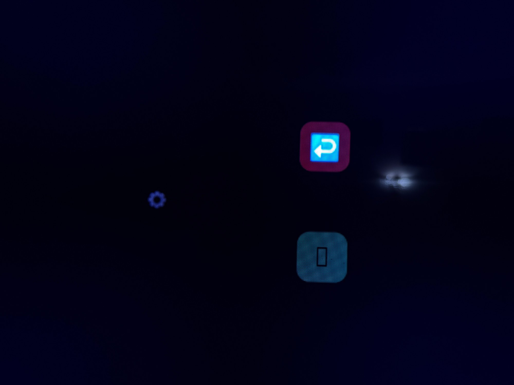
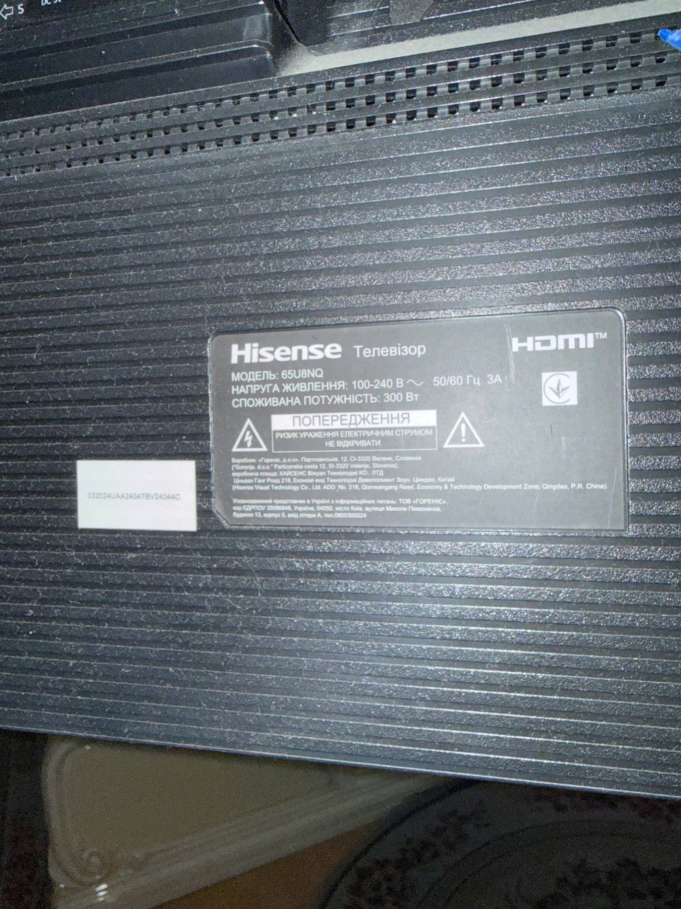
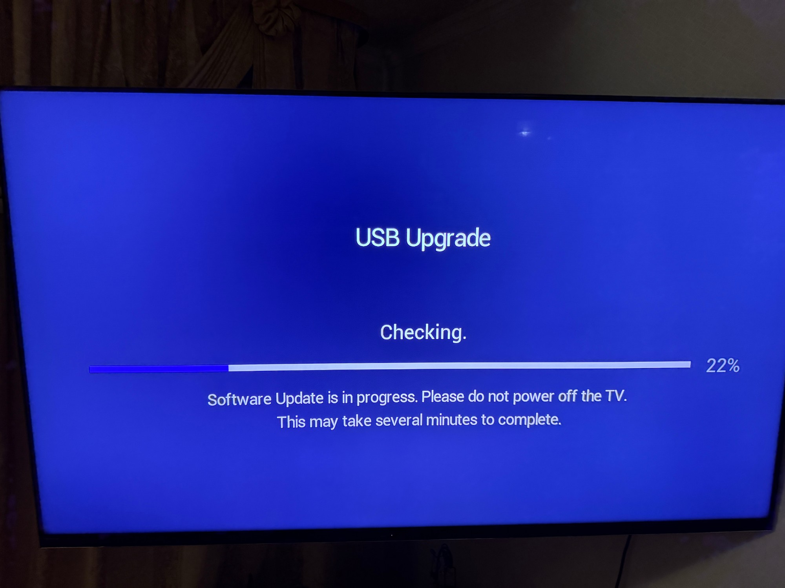
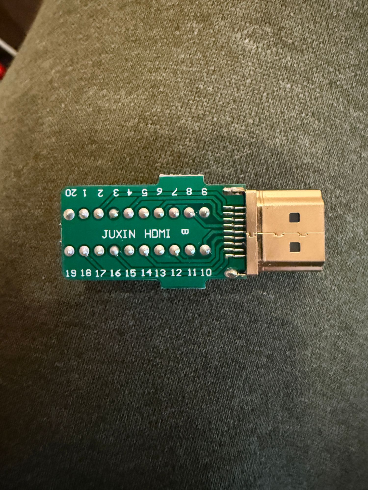

# Hisense 65U8NQ — USB Firmware Recovery

> 🇺🇦 [Українська](#українська) | 🇷🇺 [Русский](#русский) | 🇬🇧 [English](#english)

---

## English

### The Problem

We were developing a **custom VIDAA launcher** for this TV. During development, the file `/APPS/pkgs/tv.vidaa.app.ui/packageinfo.json` got corrupted — this is the app manifest the VIDAA system uses to register the main UI.

The result: the TV boots, shows the half-loaded custom launcher interface, then hangs — no menu, no input response. Remote only works for power.

**This is NOT a black screen.** The TV boots fully into the broken custom launcher state:



*What we saw after every boot: custom launcher partially loaded, completely frozen*

The TV is **not fully bricked** — bootloader, kernel, and init all run fine. Only the VIDAA app layer is broken. This is fully recoverable at home with a USB drive.

---

### TV Specs

| Field | Value |
|-------|-------|
| Rear label | 65U8NQ |
| Internal model | 65U85LEVS |
| Project | 76931 |
| SoC | MediaTek MT9618 (Pentonic 1000) |
| OS | VIDAA 6.x |
| Firmware | V0000.09.61B / E006 (O0410) |



---

### The Fix — USB Firmware Recovery

#### What you need
- USB flash drive, **≤32 GB** (8–16 GB ideal)
- Formatted **FAT32, MBR** (not GPT, not exFAT, not NTFS)
- The correct firmware package for your model

#### Step 1 — Get the firmware

**Direct download (verified):** [76931_65U85LEVS_Hisense_E006_O0410.zip (~854 MB) — Google Drive](https://drive.google.com/file/d/14iirG5aEXPRtbzyhkm0ugyLNpeqfkK0q/view?usp=sharing)

The ZIP contains `MTK_9618_EU_G_pkg_20240410.tar.gz` → inside is `usb_MTK_9618_EU_G.bin` (894,841,488 bytes).

SHA256 of `usb_MTK_9618_EU_G.bin`: `4c3569e27734e8659aec6b8554acab1fbdc0d1e7680abfab2244eea69b3e7c32`

#### Step 2 — Prepare the USB drive (macOS)

```bash
# Replace diskN with your actual disk (check: diskutil list)
diskutil eraseDisk FAT32 HISENSE MBRFormat /dev/diskN

# Prevent macOS metadata files from being written
sudo mdutil -i off /Volumes/HISENSE
touch /Volumes/HISENSE/.metadata_never_index

# Extract firmware directly to USB
unzip -p ~/Downloads/76931_65U85LEVS_Hisense_E006_O0410.zip \
  | tar -xzOf - usb_MTK_9618_EU_G.bin \
  > /Volumes/HISENSE/usb_MTK_9618_EU_G.bin

# Verify file size (must be exactly 894841488 bytes)
stat -f %z /Volumes/HISENSE/usb_MTK_9618_EU_G.bin

# ⚠️ CRITICAL — rename the file, the bootloader requires this exact name
mv /Volumes/HISENSE/usb_MTK_9618_EU_G.bin /Volumes/HISENSE/Forcedupgrade_001.bin

# Remove macOS hidden files, then eject
dot_clean -m /Volumes/HISENSE
sync && diskutil eject /dev/diskN
```

> **Why rename?** The bootloader looks for `Forcedupgrade_001.bin`. With the original filename `usb_MTK_9618_EU_G.bin` the TV completely ignores the USB drive and boots straight into the broken launcher — no error, no message.

#### Step 3 — Flash the TV


*Back panel: use the USB port on the HDMI side (left when facing the TV)*

1. Insert USB into the **USB port on the same side as the HDMI ports** (labeled USB 1 on this model — this is the port that worked)
2. Power on the TV normally with the remote
3. The TV shows a **blue screen: "USB Upgrade — Checking."** with a progress bar



*Success: "USB Upgrade — Checking. 22%" — do not power off*

4. **Do NOT power off. Do NOT remove the USB.** Wait 10–20 minutes.
5. TV reboots automatically → Hisense logo → first-time setup wizard
6. Remove USB after the logo appears
7. Go to Settings → Support → Factory Reset to clean up

---

### What We Tried That Did NOT Work

This section documents everything we attempted before finding the solution. If you're stuck, this may save you days of work.

#### ❌ USB with original filename (`usb_MTK_9618_EU_G.bin`)
Bootloader silently ignores it. TV boots to broken launcher as if no USB is present. No error. **Renaming to `Forcedupgrade_001.bin` is mandatory.**

#### ❌ 62 GB USB drive
Large FAT32 volumes are unreliable with MTK bootloaders. Use ≤32 GB.

#### ❌ Other USB port
Only the USB port on the HDMI side (USB 1) worked. The other port was not accepted by the bootloader.

#### ❌ Physical button hold during power-on
On the 65U8NQ the physical button does not trigger USB recovery mode via hold-at-power-on. The button simply boots the TV into whatever it loads first (skips the Hisense logo, goes straight to the broken launcher).

#### ❌ UART via 3.5mm SERVICE port

The TV has a 3.5mm SERVICE port on the back. UART should be accessible here (TIP=TX, RING=RX, SLEEVE=GND). Tested with FT232RL adapter at all standard baud rates: **921600, 460800, 230400, 115200, 57600**. Zero output at all baud rates. UART is disabled in production firmware on MTK9618.

#### ❌ UART via HDMI DDC pins (pins 15 and 16)




We used a JUXIN HDMI Male Plug with screw terminals (no soldering needed) to access individual HDMI pins. Tested pins 15 (DDC Clock) and 16 (DDC SDA) as UART TX/RX candidates with FT232RL adapter:


Same result — zero output at any baud rate. UART disabled in production on this model.

**Color coding used (for reference):**  
🟡 Yellow = RX | 🔵 Blue = TX | ⚫ Black = GND

#### ❌ MQTT commands (port 36669)
Port 36669 accepts TLS connections, but VIDAAcommon is dead when `packageinfo.json` is corrupt. All commands are silently ignored. Tested: launchapp, sendkey, factory_reset, resetLauncher, setprop, exec, reboot — zero responses.

#### ❌ DNS spoof for OTA recovery
VIDAAcommon not running → HTTP client processes never start → TV makes zero TCP connections to external servers. DNS queries run but no TCP follows. VPS was set up, nginx configured — TV never connected.

#### ❌ AirPlay (port 7000)
Returns 403 on all endpoints (/pair-setup, /fp-setup, /play).

#### ❌ DIAL (port 3366/3367)
Discovery XML responds, but app launch returns 404 — VIDAAcommon not registering apps.

---

### Hardware We Bought That Wasn't Needed

We spent money on UART hardware before finding the USB solution. Listed here so others don't repeat this mistake:

| Item | Cost (approx) | Why we bought it | Result |
|------|---------------|-----------------|--------|
| FT232RL USB-UART adapter (3.3V, TYPE-C) | ~5 USD | UART console via SERVICE port or HDMI | UART disabled in firmware |
| JUXIN HDMI Male Plug with screw terminals | ~3 USD | Access HDMI pins without soldering | No UART signal on pins 15/16 |
| Dupont F-F wires (10–20cm pack) | ~1 USD | Connections | Not needed |

**Total wasted: ~$9 and several days.**  
**Lesson: Try USB firmware recovery with the correct filename *first*, before buying any hardware.**

---

### Technical Background

#### eMMC partition layout (MTK9618, 42 partitions)
```
p20:  rootfs squashfs ~36 MB  (read-only system)
p37:  /usr/local       245 MB
p38:  /opt             665 MB  (MQTT broker: /opt/iot/mosquitto)
p39:  /var/local       348 MB  (writable, boot hooks)
p41:  /APPS            614 MB  (ext4 — target partition)
p42:  /OAD             921 MB  (OTA staging — DO NOT TOUCH)
```

#### The broken file
```
/APPS/pkgs/tv.vidaa.app.ui/packageinfo.json
```
When empty or corrupt → VIDAA app manager cannot register the main UI package → VIDAAcommon fails to start → no ports open → no network recovery possible.

#### Why MQTT can't help
VIDAAcommon registers app packages on boot. Without a valid `packageinfo.json` for `tv.vidaa.app.ui`, VIDAAcommon's command handlers never initialize. The MQTT broker starts (port 36669 is open) but it's a dead socket — no subscriber handlers are registered. Even with valid credentials, every publish is dropped.

---

### If USB Recovery Still Doesn't Work

1. **Different USB drive** — try another brand/size (8–16 GB), some drives don't enumerate correctly in the MTK bootloader
2. **UART via mainboard test pads** — there is a 3-pad group near the MT9618 SoC on the mainboard, 115200 baud 8N1 3.3V. Use U-boot shell to directly edit the broken JSON on eMMC:
   ```
   ext4ls mmc 0:41 pkgs/tv.vidaa.app.ui
   # read working packageinfo from another package, copy format, fix the broken one
   ```
3. **eMMC ISP** — a repair shop with Easy-JTAG / UFI box can read/write eMMC in-circuit without desoldering (~$20–60 USD, ~800–2500 UAH)

---

### Contributing

If this worked on a different Hisense model, open a PR with:
- TV model and internal name
- Firmware filename and project number  
- Which USB port worked
- Any differences from these steps

---

## Українська

### Проблема

Ми розробляли **власний лаунчер для VIDAA** на цьому телевізорі. Під час розробки файл `/APPS/pkgs/tv.vidaa.app.ui/packageinfo.json` пошкодився — це маніфест, через який VIDAA реєструє головний UI.

Результат: телевізор завантажується, показує частково завантажений кастомний лаунчер і зависає. Пульт реагує тільки на кнопку живлення.

**Це не чорний екран.** Телевізор завантажується у зламаний стан кастомного лаунчера (дивись фото вище).

Телевізор **не повністю зламаний** — завантажувач і ядро Linux працюють нормально. Відновлення можливе вдома з флешкою.

### Рішення — коротко

1. Флешка **≤32 ГБ**, FAT32, MBR
2. Завантаж архів [`76931_65U85LEVS_Hisense_E006_O0410.zip` (~854 МБ) — Google Drive](https://drive.google.com/file/d/14iirG5aEXPRtbzyhkm0ugyLNpeqfkK0q/view?usp=sharing)
3. Розпакуй `usb_MTK_9618_EU_G.bin` на флешку
4. **Перейменуй** у `Forcedupgrade_001.bin` — ОБОВ'ЯЗКОВО
5. Вставте у **USB порт з боку HDMI** (USB 1 на цій моделі)
6. Увімкни телевізор пультом як звичайно
7. Має з'явитись синій екран **"USB Upgrade — Checking."** з прогрес-баром
8. Чекай 10–20 хвилин, **не вимикай**

### Що точно не спрацює

- Оригінальна назва `usb_MTK_9618_EU_G.bin` — ігнорується завантажувачем
- Флешка >32 ГБ — ненадійна з MTK завантажувачем
- Інший USB порт — спрацював тільки USB 1 (з боку HDMI)
- Утримання фізичної кнопки на корпусі — не запускає recovery режим
- UART через SERVICE порт (3.5mm) — UART вимкнено у production прошивці
- UART через HDMI піни 15/16 (DDC) — теж нічого, нуль даних
- MQTT команди через порт 36669 — VIDAAcommon мертвий, всі команди ігноруються
- DNS-спуфінг для OTA — TV не робить TCP-з'єднань коли VIDAAcommon не працює

### Куплене обладнання яке не знадобилось

- **FT232RL USB-UART адаптер** (3.3V, TYPE-C, ~200 грн) — UART вимкнено у прошивці
- **HDMI Male Plug з клемниками JUXIN** (без паяння, ~120 грн) — сигналу на пінах 15/16 немає
- **Дроти Dupont** (~50 грн) — не знадобились

**Висновок:** спочатку спробуй USB recovery з правильною назвою файлу, перш ніж купувати будь-яке залізо.

---

## Русский

### Проблема

Мы разрабатывали **собственный лаунчер для VIDAA** на этом телевизоре. В процессе разработки файл `/APPS/pkgs/tv.vidaa.app.ui/packageinfo.json` повредился — это манифест, через который VIDAA регистрирует главный UI.

Результат: телевизор загружается, показывает частично загруженный кастомный лаунчер и зависает. Пульт реагирует только на кнопку питания.

**Это не чёрный экран.** Телевизор загружается в сломанное состояние кастомного лаунчера (см. фото выше).

Телевизор **не полностью сломан** — загрузчик и ядро Linux работают нормально. Восстановление возможно дома с флешкой.

### Решение — коротко

1. Флешка **≤32 ГБ**, FAT32, MBR
2. Скачай архив [`76931_65U85LEVS_Hisense_E006_O0410.zip` (~854 МБ) — Google Drive](https://drive.google.com/file/d/14iirG5aEXPRtbzyhkm0ugyLNpeqfkK0q/view?usp=sharing)
3. Распакуй `usb_MTK_9618_EU_G.bin` на флешку
4. **Переименуй** в `Forcedupgrade_001.bin` — ОБЯЗАТЕЛЬНО
5. Вставь в **USB порт со стороны HDMI** (USB 1 на этой модели)
6. Включи телевизор пультом как обычно
7. Должен появиться синий экран **"USB Upgrade — Checking."** с прогресс-баром
8. Жди 10–20 минут, **не выключай**

### Что точно не работает

- Оригинальное имя `usb_MTK_9618_EU_G.bin` — игнорируется загрузчиком без каких-либо сообщений
- Флешка >32 ГБ — ненадёжна с MTK загрузчиком
- Другой USB порт — сработал только USB 1 (со стороны HDMI)
- Удержание физической кнопки при подаче питания — не запускает recovery
- UART через SERVICE порт (3.5mm) — UART отключён в production прошивке
- UART через HDMI пины 15/16 (DDC) — нуль данных на всех скоростях
- MQTT команды через порт 36669 — VIDAAcommon мёртв, всё игнорируется
- DNS-спуфинг для OTA — TV не делает TCP-соединений когда VIDAAcommon не работает

### Купленное оборудование, которое не понадобилось

- **FT232RL USB-UART адаптер** (3.3V, TYPE-C, ~200 грн) — UART отключён в прошивке
- **HDMI Male Plug с клеммниками JUXIN** (без пайки, ~120 грн) — сигнала на пинах 15/16 нет
- **Провода Dupont** (~50 грн) — не понадобились

**Итог:** сначала попробуй USB recovery с правильным именем файла, прежде чем тратить деньги на оборудование.
